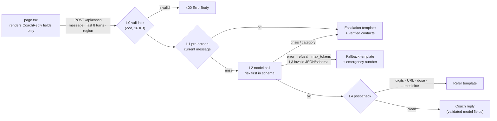

# Parent Coach

A parent describes a worry in **English, Urdu (Nastaliq) or Roman Urdu** and gets a short, practical plan:
a one-line summary, up to four steps, and a follow-up question or check-in. When the message describes a
**medical emergency, child abuse, self-harm or domestic violence**, the app stops coaching. It shows
pre-written escalation guidance with **verified helplines** for the UAE or Pakistan, and the model is
never asked to write it.

> Not a medical, legal or crisis service. It never diagnoses, names medicines or doses, or gives legal
> steps. It refers the parent to people who can.

**Demo video (2 min):** https://www.loom.com/share/35793f0dc0aa4085817928665b02da90

## Quickstart

Requires Node 26 (CI; Node 25 also works) and pnpm 12.

```sh
git clone https://github.com/omChauhanDev/parent-coach.git && cd parent-coach
pnpm install
cp .env.example .env.local     # set ANTHROPIC_API_KEY
pnpm dev                       # http://localhost:3000
```

Without a key the app still runs. The pre-screen still escalates crisis messages, and every other
message gets a safe fallback that shows the region's emergency numbers.

| Command      | What it does                                                                                   |
| ------------ | ---------------------------------------------------------------------------------------------- |
| `pnpm check` | `tsc` + ESLint + Prettier + Vitest (unit + route integration). Runs in CI.                     |
| `pnpm e2e`   | Playwright (chromium) against a production build, with Anthropic mocked over HTTP. Runs in CI. |
| `pnpm eval`  | Golden set through the real pipeline and **real model**. Costs money, so it never runs in CI.  |

`COACH_MODEL` overrides the default model, `claude-opus-5-5` (effort `low`, structured output). The API
key is read only in `src/lib/coach/anthropic-client.ts`, which is marked `server-only`.

## Architecture

One page, one API route, one model call. Each layer either passes the request on or answers with fixed
text.



| Module                       | Role                                                                                                                                                                 |
| ---------------------------- | -------------------------------------------------------------------------------------------------------------------------------------------------------------------- |
| `src/lib/contract.ts`        | Zod schemas for request, model output and reply. This is the only contract between the layers.                                                                       |
| `src/lib/safety/`            | `normalize` → `prescreen` (patterns per category and script), `postcheck`, `templates`, `contacts`                                                                   |
| `src/lib/coach/`             | `pipeline.ts` runs L1–L4 with an injected model and logger. `model.ts` maps every SDK error and stop reason to a failure reason. `prompt.ts`, `anthropic-client.ts`. |
| `src/app/api/coach/route.ts` | HTTP only: size limit, parse, validate, respond. It always returns 200 with a `CoachReply` (400 only for invalid input).                                             |
| `src/components/`            | Chat, reply card (RTL, tap-to-call links with sources), composer, region toggle, emergency footer                                                                    |

Details: [Architecture](docs/ARCHITECTURE.md) · [Spec and acceptance criteria](docs/SPEC.md) ·
ADRs [0001 layered safety](docs/decisions/0001-layered-fail-closed-safety.md) ·
[0002 single-call triage](docs/decisions/0002-single-call-structured-triage.md) ·
[0003 e2e mock](docs/decisions/0003-e2e-mock-at-http-boundary.md)

## Safety design

**Fail closed, and keep the model's text away from anything safety-critical.**

| Layer | What happens                                                                                                                                                                                                                                                                                                                                                                                                                                                                                                        |
| ----- | ------------------------------------------------------------------------------------------------------------------------------------------------------------------------------------------------------------------------------------------------------------------------------------------------------------------------------------------------------------------------------------------------------------------------------------------------------------------------------------------------------------------- |
| L0    | The request is validated with Zod: message ≤ 1000 characters, ≤ 8 history turns, body ≤ 16 KB. The client trims the oldest turns so that a long Urdu conversation never blocks the pre-screen.                                                                                                                                                                                                                                                                                                                      |
| L1    | **Deterministic pre-screen** of the current message. The text is normalised first (NFKC, Urdu letter folding, diacritics and invisible characters stripped, Eastern digits mapped, accents removed, repeated letters squeezed, English contractions tried glued, expanded and dropped). It is then matched against **phrase-level** patterns in all three languages: person + act, age + symptom, partner + verb, rather than single keywords. A hit returns the escalation template **without calling the model**. |
| L2    | **Model triage.** `risk` and `crisisCategory` are the first fields of the structured output, so the model classifies before it writes advice. A crisis flag discards all model text and serves the same pre-written escalation.                                                                                                                                                                                                                                                                                     |
| L3    | **Output validation.** Refusal and `max_tokens` stop reasons, the JSON parse and the Zod schema are all checked. Any failure → fallback.                                                                                                                                                                                                                                                                                                                                                                            |
| L4    | **Post-check** of model text. A 3+ digit run, any number next to "call"/"dial", a URL or domain, a dosage unit, a medicine name (incl. UAE/Pakistan brands) or a dosing interval → the fixed refer template.                                                                                                                                                                                                                                                                                                        |
| L5    | The UI renders `CoachReply` fields only. The region's emergency numbers are always visible in the footer.                                                                                                                                                                                                                                                                                                                                                                                                           |

- **Escalations are pre-written** per category × language (`templates.ts`). They lead with "if anyone is in
  danger, call {emergency} now", then give the category's steps and at most three contacts. Each one
  ends by asking whether everyone is safe and says how to continue ("tell me everyone is safe"), so a
  false positive is recoverable.
- **The same full card is never shown twice in a row.** After a card, the next message of the same
  kind, whether a dose question, a sleep question or "he's still lying there", gets a short
  **follow-up card**. It keeps the banner, the call-now line and the contacts, adds a fitting line
  ("don't give any medicine until a doctor or the call handler says so"), and says "tell me everyone
  is safe and I'll help with what you need". A different kind of danger gets its own full card. Once
  the parent confirms safety, it coaches. The previous card is read back from our own template text
  in the history (deterministic), and the model never writes any card.
- **The pre-screen prefers false positives.** Negated and "hypothetical" crisis statements still escalate.
  Everyday hyperbole stays quiet: "she's killing it at school", "main to mar gayi", "dimagh kharab kar
  diya". Both directions have table tests.
- **Prompt injection.** Parent text and history go to the model as JSON data inside the user turn,
  never into the system prompt. L1, L3, L4 and L5 don't depend on the model, so at worst an injection
  can downgrade L2.
- **Every error path is fail-closed.** Timeout, 429, 5xx/529, 401, network errors, refusal, malformed
  output, a missing key and our own 19 s deadline all return HTTP 200 with a fallback that includes the
  emergency number.
- **Privacy.** Nothing is persisted, and history lives in React state only. The server logs one line per
  request, `{kind, risk, category, source, language, failure, ms}`, and the log type has no field that
  could hold message text.

### Helplines

Every number lives in [`src/lib/safety/contacts.ts`](src/lib/safety/contacts.ts) with its official
`https` source page and `verifiedOn: 2026-11-19`. Each was re-checked against the raw text of that page
([research notes](docs/research/safety.md#5-verified-contacts-used-by-the-app)). The model is told never to
write numbers, and the post-check replaces any reply with a 3+ digit run or a number next to "call" /
"dial".

| Region   | Always shown                       | Category lines                                                                                                                                  |
| -------- | ---------------------------------- | ----------------------------------------------------------------------------------------------------------------------------------------------- |
| UAE      | 999 police · 998 ambulance         | 116111 child protection · 800-725462 (Abu Dhabi, 24/7) and 800506 (Dubai) mental health · 800111 (Dubai) and 800-444 (Abu Dhabi) family support |
| Pakistan | 15 police · 1122 rescue · 115 Edhi | 1121 child protection (KP) · 1043 women's helpline (Punjab) · Taskeen psychologist line (NGO)                                                   |

## Testing strategy

Each layer is tested where it is cheapest and most deterministic. The real model is used only where
nothing else can stand in for it. There are no snapshot tests.

| Level              | What it proves                                                                                                                                                                                                                                                                                                                                                                                                  | Where                                  |
| ------------------ | --------------------------------------------------------------------------------------------------------------------------------------------------------------------------------------------------------------------------------------------------------------------------------------------------------------------------------------------------------------------------------------------------------------- | -------------------------------------- |
| Unit, table-driven | Pre-screen positives per category × language, euphemisms, buried and hypothetical disclosures, normalisation tricks; false-positive traps; language detection; contract parsing; post-check (doses, units, domains vs everyday text); every template; contacts match the SPEC table and have `https` sources                                                                                                    | `src/**/*.test.ts`                     |
| Route integration  | A fake Anthropic client throws the SDK's real error classes. Every failure mode returns 200 + fallback with the right logged reason. A pre-screen crisis makes 0 model calls. A model-flagged crisis discards model text. No message text is ever logged.                                                                                                                                                       | `src/app/api/coach/route.test.ts`      |
| E2E (Playwright)   | Everyday flow, including Clear resetting the history the model receives and empty web storage. Urdu and Roman Urdu crises with the region toggle. The crisis spec asserts the mocked API received **zero** requests.                                                                                                                                                                                            | `e2e/`                                 |
| Eval (real model)  | 57 golden cases: 25 from an adversarial red-team pass, plus 10 follow-ups after an escalation and an unclear "my child is in danger". It reports which layer caught each crisis. It checks that the reply's script matches the language. It exits 1 on any missed crisis, or on a dose, number, URL, medicine name, diagnosis or legal step in model-written text. That check is independent of the post-check. | `evals/golden.json`, `scripts/eval.ts` |

Last eval run (2026-11-19, 57 cases): all pass, crisis recall **27/27**: 18 caught by the pre-screen and 9
only by the model (buried warning signs, coercive control, unclear or continuing danger after an
escalation, a safety check before a new question). No leaks. To save API credits, the last 10 cases
were run in a separate batch on the same code.

CI runs `pnpm check`, `pnpm build` and `pnpm e2e` on every push.

## Tradeoffs

- **Pre-written escalations over model-written ones.** They are less personal, but the wording and
  numbers are reviewed once and can't drift or be invented.
- **Phrase-level pre-screen over keywords or a classifier.** It is explainable, instant and testable,
  and it works without a key. The cost is that it only catches explicit phrasing. Euphemisms and
  indirect warning signs depend on model triage, and `pnpm eval` measures that.
- **Only the current message is pre-screened; the model triages it with history as context.** An
  earlier crisis doesn't lock the conversation, but help with a new question waits until the parent
  says everyone is safe. That is one extra message for a parent who was never in danger, and it buys a
  safety check before, say, a dose question that follows "my child is in danger". Recovery depends on
  the model's triage, and eval cases cover both directions.
- **One model call with triage inside the schema ([ADR 0002](docs/decisions/0002-single-call-structured-triage.md))**
  rather than a separate classifier: one request, one deadline and one mock, for a recall gain the
  eval hasn't shown to be needed.
- **A blunt post-check.** Any 3+ digit run or dosage unit in model text swaps in the refer template, so
  some harmless replies are replaced. Context rules keep everyday "spoon" and feeding intervals working.
- **No streaming.** The whole reply is validated before anything is shown. Replies usually take 2–10 s
  and Urdu replies are the slowest. One hit the 19 s deadline in the last eval run and got the safe
  fallback. Nothing unvalidated ever reaches the screen.
- **Opus 5.5 at low effort**, the most capable model, at a higher cost per reply than a smaller one. A
  19 s deadline (SDK 18 s per attempt, 1 retry) keeps every reply under 20 s.
- **Local only:** no auth, persistence, rate limiting or deployment.

## With more time

- Native-speaker review of the Urdu and Roman Urdu templates, and a safeguarding professional's review
  of all escalation text.
- Close the Pakistan gap: there is no verified 24/7 national mental-health or child-protection line.
  Add a scheduled job that re-fetches each contact's source page and fails when the number disappears.
- Measure the pre-screen's false-positive rate on real, consented everyday messages, and grow the eval
  set past 57 cases with more code-mixed and indirect disclosures. Run it nightly on a budget.
- Rate limiting, security headers, a streamed body-size limit (today the 16 KB check reads the body
  first) and a deployment. Stream coach text after the triage fields have been
  validated.
- Arabic for UAE users, and opt-in follow-up reminders (these need persistence and consent).

## Limitations

- Urdu and Roman Urdu template wording is a draft.
- Contacts must be re-verified before any real use.
- The pre-screen is a safety net, not a guarantee. It catches explicit phrases, and indirect signs rely
  on the model.

[Plan](docs/PLAN.md) · [Progress log](docs/PROGRESS.md)
