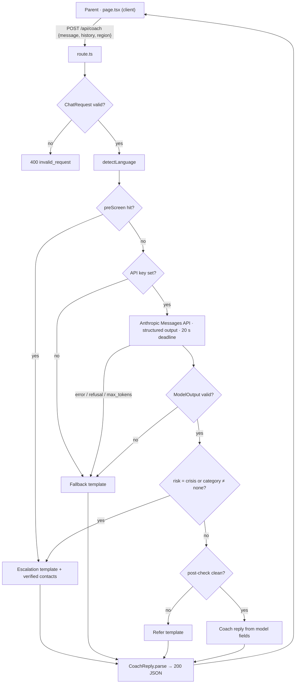

# Architecture

## 1. Overview

## 2. Request lifecycle
1. **Client** sends `{message, history (last 8 turns; coach turns flattened to text), region}`.
2. **Route** reads the body as text (reject > 16 KB → 400), `JSON.parse` in try/catch, `ChatRequest.safeParse` → 400 `ErrorBody` on failure.
3. `detectLanguage(message)` → `en | ur | roman_ur`.
4. `preScreen(message)` normalises and matches patterns; the first category by priority wins.
5. **Hit** → `buildEscalation(category, language, region, "prescreen")` → step 9.
6. **Miss** → if `ANTHROPIC_API_KEY` is missing → fallback (`config`). Otherwise `coachModel.generate({message, history, language})` under a 20 s AbortController deadline (SDK `timeout: 15_000`, `maxRetries: 1`).
7. `model.ts` maps the outcome to `{ok: true, output}` or `{ok: false, reason}` (see §4); it uses `messages.create` with `output_config.format = zodOutputFormat(ModelOutput)`, checks `stop_reason`, takes the text block, `JSON.parse`, `ModelOutput.safeParse`.
8. **Triage gate**: crisis or category ≠ none → escalation (source `model`). Else **post-check** → coach reply, or the refer template on violation.
9. `CoachReply.parse(reply)`; if our own reply fails validation, a hard-coded English fallback constant is sent. One log line (§6.6 of SPEC). Respond 200.

## 3. Module boundaries

| Module | Responsibility | Must not |
|---|---|---|
| `src/app/page.tsx` + `src/components/*` | UI state (turns, region, pending); renders `CoachReply` fields only; footer emergency numbers | import server modules, call Anthropic, use web storage |
| `src/app/api/coach/route.ts` | HTTP only: size limit, parse, validate, call pipeline, respond | contain safety or model logic |
| `src/lib/contract.ts` | Zod schemas + inferred types (SPEC §5) | depend on anything but zod |
| `src/lib/language.ts` | `detectLanguage` | — |
| `src/lib/safety/normalize.ts` | text normalisation (research §4) | — |
| `src/lib/safety/patterns.ts` | pattern data per category × script | contain logic |
| `src/lib/safety/prescreen.ts` | `preScreen(text) → {category, patternId} \| null` | call the model |
| `src/lib/safety/contacts.ts` | verified contacts per region × category (research §5) | hold unverified numbers |
| `src/lib/safety/templates.ts` | escalation / refer / fallback text per language | invent numbers (interpolates from contacts) |
| `src/lib/safety/postcheck.ts` | screen model text (digits, URLs, dosage units) | — |
| `src/lib/coach/prompt.ts` | system prompt; history → `MessageParam[]` | — |
| `src/lib/coach/model.ts` | `createCoachModel(client)` → `generate()`; SDK errors / stop reasons → failure reasons | throw to callers |
| `src/lib/coach/anthropic-client.ts` | `import "server-only"`; builds the client from env (explicit `apiKey`, timeout, retries) | be imported by client code |
| `src/lib/coach/pipeline.ts` | `handleChat(request, deps)`: orchestrates L1–L4 with injected model and logger; no `server-only` so `pnpm eval` can reuse it | read env or construct clients |
| `scripts/eval.ts` | runs `evals/golden.json` through the pipeline with the real client | run in CI |
| `e2e/mock-anthropic.ts` | local mock of `POST /v1/messages`, `GET /health`, `GET /__count` | — |

## 4. Failure modes

| Failure | Detected by | Parent sees | HTTP | Log `failure` |
|---|---|---|---|---|
| Body > 16 KB, invalid JSON, schema failure, empty / > 1000-char message | route + `ChatRequest` | inline error; composer prevents most cases | 400 | `invalid_request` |
| `ANTHROPIC_API_KEY` missing | pipeline, before the call | fallback (pre-screen still works) | 200 | `config` |
| SDK timeout or our 20 s deadline | `APIConnectionTimeoutError`, `APIUserAbortError` | fallback | 200 | `timeout` |
| Rate limited | `RateLimitError` (429) | fallback ("busy, try again in a minute") | 200 | `rate_limit` |
| Overloaded / server error | `OverloadedError` (529), `InternalServerError` (5xx) | fallback | 200 | `upstream` |
| Bad key | `AuthenticationError` (401) | fallback | 200 | `auth` |
| Our request rejected | `BadRequestError` (400) | fallback | 200 | `bad_request` |
| Network | `APIConnectionError` | fallback | 200 | `network` |
| Refusal | `stop_reason === "refusal"` | fallback | 200 | `refusal` |
| Truncated | `stop_reason === "max_tokens"` | fallback | 200 | `max_tokens` |
| No text block / not JSON / schema mismatch | `model.ts` | fallback | 200 | `malformed` |
| Digits, URL or dosage unit in model text | `postcheck.ts` | refer template | 200 | `postcheck` |
| Model flags crisis | triage gate | escalation template (source `model`) | 200 | — |
| Anything unexpected | top-level try/catch | fallback; no error text leaked | 200 | `unexpected` |
| Client fetch fails / non-JSON | `page.tsx` | local message "Couldn't reach the coach — try again"; footer numbers stay visible | — | — |

Every fallback includes "If anyone may be in danger, call {emergency} now" for the selected region.

## 5. Configuration
| Variable | Where | Purpose |
|---|---|---|
| `ANTHROPIC_API_KEY` | `.env.local` (git-ignored); `.env.example` documents it | Required for coaching; pre-screen and escalations work without it |
| `COACH_MODEL` | optional | Defaults to `claude-opus-5-5` |
| `ANTHROPIC_BASE_URL` | tests only (Playwright `webServer.env`) | Points the SDK at `e2e/mock-anthropic.ts` |

Model call: `claude-opus-5-5`, `output_config: { effort: "low", format: zodOutputFormat(ModelOutput) }`,
`max_tokens: 16000`, non-streaming. No `temperature` (rejected by the current API version).

## 6. Stack (exact pins, verified 2026-11-19)
| Area | Packages |
|---|---|
| Framework | next 16.4.6 · react / react-dom 19.3.1 · eslint-config-next 16.4.6 |
| Language | typescript 6.0.3 (7.x breaks typescript-eslint) · @types/node 26.6.6 · @types/react / @types/react-dom 19.3.0 |
| LLM + schema | @anthropic-ai/sdk 1.10.0 · zod 4.6.7 · server-only 0.0.1 |
| Styling | tailwindcss / @tailwindcss/turbopack 4.3.5 · Noto Nastaliq Urdu via `next/font/google` |
| Lint / format | eslint 9.39.5 · prettier 3.10.1 · eslint-config-prettier 10.1.8 |
| Tests | vitest 5.1.1 · @playwright/test 1.65.1 · tsx 4.23.15 |
| Git hooks | lefthook 2.2.2 (`jobs`, `piped: true`) · @commitlint/cli + config-conventional 21.2.4 |
| Package manager | pnpm 12.21.0 via `packageManager` (`allowBuilds` in `pnpm-workspace.yaml`) |
| CI | GitHub Actions: checkout@v7 · pnpm/action-setup@v6 · setup-node@v7 (Node 26 LTS, pnpm cache) · upload-artifact@v7 |

## 7. Testing strategy
| Layer | What | Where | CI |
|---|---|---|---|
| Unit (table-driven) | normalise, pre-screen (positives, euphemisms, buried, FP traps), language, contract parsing, post-check, contacts | `src/**/*.test.ts` | yes |
| Integration | `POST` route with a fake Anthropic client throwing real SDK error classes: everyday, prescreen crisis, model crisis, refer, malformed, timeout, 429, 5xx, 401, refusal, max_tokens, missing key, post-check, 400s | `src/app/api/coach/route.test.ts` (`@vitest-environment node`) | yes |
| E2E | Playwright, chromium: everyday + crisis (asserts mock received 0 requests); mock Anthropic over HTTP (ADR 0003) | `e2e/*.spec.ts` | yes |
| Eval | 15–20 golden cases against the real model; deterministic assertions; reports which layer caught each crisis | `evals/golden.json`, `scripts/eval.ts` | **no** (costs money, non-deterministic) |

No snapshot tests. Vitest aliases `server-only` to an empty stub.
